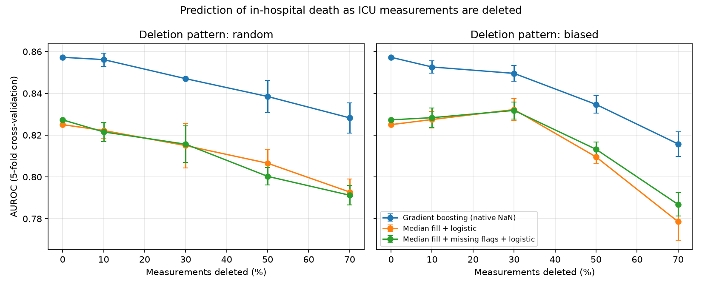

# How do missing observations affect prediction in ICU data?

A small study of how deleting measurements from irregularly sampled ICU records changes how well a model predicts in-hospital death, and which ways of handling missing values hold up.

Built in November 2026 as exploratory work on missing and irregular observations in health data.

## Question

Routine health data is incomplete: variables are recorded at irregular times, and some are never recorded for many patients. How much does predictive performance fall when more observations are missing, does it matter whether they go missing at random or in a biased way, and do some methods cope better than others?

## Data

PhysioNet/Computing in Cardiology Challenge 2012, training set A: 4,000 adult ICU patients, each with up to 36 variables recorded irregularly during the first 48 hours, plus the in-hospital death outcome (13.9% of patients).

- Source: [PhysioNet Challenge 2012](https://physionet.org/challenge/2012). Silva I, Moody G, Mark R, Celi LA. *Predicting Mortality of ICU Patients: The PhysioNet/Computing in Cardiology Challenge 2012.*
- Licence: Creative Commons Attribution 3.0.
- The data is not included in this repository. Download `set-a.zip` and `Outcomes-a.txt` from the dataset page and place them in `data/raw/`.

## Method

1. **Load** each patient's irregular records into one long table (`src/01_load_and_explore.py`).
2. **Features**: for each variable, summarise a patient's measurements as mean, min, max, last value and count (`src/features.py`, `src/02_build_features.py`). Scores such as SAPS-I and SOFA, and length of stay, are not used as inputs because they would leak the outcome.
3. **Baseline**: logistic regression and gradient boosting with no data deleted, scored by AUROC with 5-fold cross-validation (`src/03_baseline.py`).
4. **Experiment** (`src/04_missingness_experiment.py`): delete 10%, 30%, 50% and 70% of all measurements, rebuild the features, and re-score three methods. Each condition is repeated 3 times with different random deletions.
   - **Random deletion**: every measurement is equally likely to be deleted.
   - **Biased deletion**: values far from the variable's typical range are more likely to be deleted, a simple form of missingness that depends on the value itself.
   - **Methods**: median fill + logistic regression; median fill + "was missing" flags + logistic regression; gradient boosting using its built-in handling of missing values.

## Results



| Condition | Gradient boosting | Median fill + logistic |
|---|---|---|
| Nothing deleted | 0.857 | 0.825 |
| Random, 30% deleted | 0.847 | 0.815 |
| Random, 50% deleted | 0.838 | 0.807 |
| Biased, 50% deleted | 0.835 | 0.810 |
| Biased, 70% deleted | 0.816 | 0.779 |

Mean AUROC over repeats. Full results are in `reports/missingness_results.csv`.

- Performance falls gradually: about 0.01 AUROC at 30% deleted, about 0.02 at 50%, and 0.04 to 0.05 at 70% biased deletion.
- Gradient boosting stayed ahead of logistic regression by about 0.02 to 0.04 in every condition shown, and the gap did not systematically widen as more data was deleted. Its lead is therefore not evidence that handling missing values natively makes it more robust.
- Adding "was missing" flags gave no consistent benefit; differences were within the run-to-run noise.
- Mild biased deletion (10% to 30%) did not reduce the logistic regression score. One possible explanation is that removing extreme values trims outliers, which I have not tested.

## Limitations

- One dataset, and only training set A. No external validation.
- Deletion is simulated and applied to all patients, in both the training and test folds. The biased pattern is only one simple form of value-dependent missingness.
- Summary features (mean, min, max, last, count) lose timing information. Many variables are measured dozens of times, so deleting half the readings often leaves enough to summarise; variables measured once are lost entirely.
- No hyperparameter tuning. Error bars reflect only the three random deletions, not uncertainty from the patient sample, so differences under about 0.01 AUROC should be treated as noise.

## Reproduce

```
py -m venv .venv
.venv\Scripts\Activate.ps1
pip install -r requirements.txt
python src\01_load_and_explore.py
python src\02_build_features.py
python src\03_baseline.py
python src\04_missingness_experiment.py
```